# RANCANG BANGUN DIAGRAM SEQUENCE TERBARU SISTEM AI-GEMPA BMKG
## Dokumentasi Alur Interaksi Komprehensif Pasca-Transformasi Arsitektur (UI-Driven Pipeline & Pay-Per-Use System)

---

**Nomor Dokumen :** BMKG/PRIME-STEP/DEV/2026/10-002  
**Referensi File  :** `development/Diagram Sequence AI-GEMPA.png` (Diagram Eksisting)  
**Terkait Dokumen :** `development/ARCHITECTURE.md`, `development/ARCHITECTURE_PAY_PER_USE.md`, `development/LAPORAN_RENCANA_PENGEMBANGAN_ARSITEKTUR_AI_GEMPA.md`  
**Penyusun        :** Tim Rekayasa Perangkat Lunak AI-GEMPA  
**Klasifikasi     :** Dokumen Desain Teknis Arsitektur Perangkat Lunak  
**Tanggal         :** 19 Oktober 2026  
**Status          :** Disetujui untuk Implementasi Arsitektur Target  

---

## DAFTAR ISI

1. [Latar Belakang & Analisis Perubahan Alur (Old vs New Flow Analysis)](#1-latar-belakang--analisis-perubahan-alur-old-vs-new-flow-analysis)
   - 1.1 Evaluasi Keterbatasan Diagram Sequence Eksisting
   - 1.2 Tabel Komparasi Alur Lama vs Alur Baru
   - 1.3 Nilai Tambah Arsitektur Baru
2. [Kode PlantUML Diagram Sequence Terbaru](#2-kode-plantuml-diagram-sequence-terbaru)
3. [Penjelasan Rinci Alur Interaksi (Detailed Flow Breakdown)](#3-penjelasan-rinci-alur-interaksi-detailed-flow-breakdown)
   - 3.1 Fase 1: Konfigurasi Pipeline Dinamis & Estimasi Harga Real-Time (Control Plane)
   - 3.2 Fase 2: Ingesti Data & Inferensi AI dengan Abstraksi Provider (Data Plane)
   - 3.3 Fase 3: Pelacakan Beban Komputasi Asinkron & Agregasi (Metering Plane)
   - 3.4 Fase 4: Pengarsipan, Persistensi Data, dan Siaran Real-Time (Storage & Broadcast)
   - 3.5 Fase 5: Penagihan Bulanan Otomatis, Pajak PPN 11%, dan Dashboard Klien (Billing Plane)
4. [Petunjuk Teknis Rendering & Integrasi](#4-petunjuk-teknis-rendering--integrasi)

---

## 1. LATAR BELAKANG & ANALISIS PERUBAHAN ALUR (OLD VS NEW FLOW ANALYSIS)

### 1.1 Evaluasi Keterbatasan Diagram Sequence Eksisting

Berdasarkan dokumen acuan visual [Diagram Sequence AI-GEMPA.png](file:///d:/Projects/GEMPA/ai-gempa-bmkg/development/Diagram%20Sequence%20AI-GEMPA.png), diagram urutan sistem saat ini hanya mencakup 5 tahapan pemrosesan sinyal seismik konvensional:
1. `1. DATA INGESTION` (Penerimaan paket SeedLink dan HTTP POST).
2. `2. AI INFERENCE PIPELINE` (Eksekusi inferensi TensorFlow dan asosiasi kaku).
3. `3. ARCHIVING & PERSISTENCE` (Penulisan ke disk arsip dan MongoDB).
4. `4. REAL-TIME FRONTEND BROADCAST` (Polling MongoDB dan siaran via Socket.IO).
5. `5. CLIENT QUERY` (Query REST endpoint `/api/events`).

Meskipun alur pemrosesan data seismik di atas telah berjalan stabil, ditemukan **keterbatasan arsitektural yang signifikan**:
* **Bersifat Statis & Monolitik:** Tidak terdapat alur bagi pengguna/operator untuk mengatur pemilihan model AI, mengganti parameter, atau menguji konfigurasi baru.
* **Ketiadaan Sistem Metrik & Akuntabilitas (*Zero Observability*):** Modul inferensi AI menjalankan komputasi berat tanpa melaporkan volume penggunaan unit atau durasi pemrosesan.
* **Absennya Model Bisnis & Kuota:** Sistem tidak memiliki mekanisme penghitungan tarif komputasi, simulasi harga, validasi kuota gratis bulanan (*free tier*), maupun pembuatan faktur.
* **Ketergantungan *Restart* Kontainer:** Setiap perubahan model mengharuskan modifikasi variabel lingkungan dan restart kontainer fisik server.

---

### 1.2 Tabel Komparasi Alur Lama vs Alur Baru

| Dimensi Perbandingan | Diagram Sequence Eksisting (`Diagram Sequence AI-GEMPA.png`) | Diagram Sequence Target Baru (Dokumen Ini) |
|---|---|---|
| **Fokus Alur** | Murni *Data Plane* (Aliran paket data seismik mentah hingga visualisasi peta). | Terintegrasi: *Control Plane* (Konfigurasi), *Data Plane* (Inferensi AI), *Metering Plane* (Pelacakan), dan *Billing Plane* (Keuangan). |
| **Pemilihan Model AI** | Kaku (*hardcoded* ke satu implementasi model TensorFlow). | Dinamis (*pluggable*) via `BaseProvider` (STA/LTA, PhaseNet, EQTransformer, PyOcto, GaMMA, NonLinLoc). |
| **Konfigurasi Sistem** | Statis via file `.env` dan kode sumber; butuh *restart* layanan. | UI-Driven Wizard interaktif dengan kompilasi revisi profil berstatus *hot-reload* melalui topik Kafka `config_events`. |
| **Simulasi Biaya** | Tidak ada. | *Real-time Price Estimation* langsung di antarmuka web (sidebar kalkulator dengan mekanisme *debounce* 500ms). |
| **Pelacakan Pemakaian** | Tidak ada pencatatan unit inferensi. | Event-driven metering: setiap *batch* inferensi memancarkan tiket ke topik Kafka `metering_events`. |
| **Agregasi Beban** | Tidak ada. | `metering_module` mengakumulasi data dengan *sliding window* 10 menit ke MongoDB koleksi `usage_daily`. |
| **Sistem Penagihan** | Tidak ada konsep billing atau invoice. | `billing_module` otomatis menerbitkan faktur resmi bulanan di koleksi `invoices` lengkap dengan potongan kuota gratis dan PPN 11%. |
| **Kompatibilitas** | Endpoint lama `/api/*` bercampur aduk. | Standardisasi REST API v2 (`/api/v2/*`) yang bersih, aman, dan berprinsip *separation of concerns*. |

---

### 1.3 Nilai Tambah Arsitektur Baru

Transformasi diagram sequence ini memberikan lompatan kapabilitas pada sistem AI-GEMPA BMKG:
1. **Hot-Reload Parameterization:** Penyesuaian nilai ambang batas (*threshold*) model seismik di lapangan dapat langsung diterapkan dalam hitungan detik tanpa memutus aliran data SeedLink.
2. **Akuntabilitas Beban GPU/CPU:** Manajemen BMKG dapat melihat laporan riil berapa ribu kali model deep learning dijalankan per hari oleh masing-masing stasiun atau unit kerja regional.
3. **Kesiapan Menuju Multi-Tenancy & Komersialisasi:** Sistem siap mendukung pembagian kerja multi-instansi dan skema PNBP (Penerimaan Negara Bukan Pajak) berkat modul kalkulasi biaya dalam mata uang Rupiah (IDR).

---

## 2. KODE PLANTUML DIAGRAM SEQUENCE TERBARU

Berikut adalah kode **PlantUML Sequence Diagram** menyeluruh yang mencerminkan arsitektur sistem baru secara lengkap. Kode ini siap dirender menjadi diagram beresolusi tinggi:

```plantuml
@startuml AI_GEMPA_Target_Sequence_Architecture
!theme plain
autonumber "<b>[00]</b>"
skinparam roundcorner 6
skinparam shadowing false
skinparam defaultFontName "Segoe UI", Arial, sans-serif
skinparam defaultFontSize 11
skinparam BoxPadding 10
skinparam ParticipantPadding 10

' Palette Styling
skinparam sequence {
    ArrowColor #2563EB
    ActorBorderColor #1E293B
    LifeLineBorderColor #64748B
    LifeLineBackgroundColor #F1F5F9
    ParticipantBorderColor #334155
    ParticipantBackgroundColor #FFFFFF
    ParticipantFontStyle bold
    BoxBorderColor #94A3B8
    BoxFontColor #0F172A
    BoxFontStyle bold
}

' ========================================================
' DEFINISI AKTOR & PARTICIPANT
' ========================================================
actor "Operator / Analis BMKG" as Operator #E0F2FE

box "Presentation Plane (tews-ui-vue)" #F8FAFC
    participant "PipelineWizard.vue\n(4-Step Form)" as UI_Wizard
    participant "PriceCalculator.vue\n(Realtime Sidebar)" as UI_Calc
    participant "BillingDashboard.vue\n(Usage & Invoices)" as UI_Billing
    participant "MapView / Leaflet\n(Live Monitor)" as UI_Map
end box

box "Control Plane (FastAPI REST v2)" #F1F5F9
    participant "CatalogService\n(manifest & rates)" as Svc_Catalog
    participant "PricingService\n(Formula & Estimator)" as Svc_Pricing
    participant "ProfileService\n(Compile & Activate)" as Svc_Profile
    participant "Controller & WS\n(Broadcast & API)" as Svc_Controller
end box

queue "Apache Kafka Broker" as Kafka #EFF6FF

box "Data Plane (AI Seismik Pipeline)" #FEFCE8
    participant "seedlink_module" as Mod_SeedLink
    participant "p_pick_module\n(BasePickProvider)" as Mod_PPick
    participant "association_module\n(BaseAssocProvider)" as Mod_Assoc
    participant "locmag_module\n(BaseLocMagProvider)" as Mod_LocMag
    participant "archiving_module" as Mod_Archive
end box

box "Metering & Billing Plane" #F0FDF4
    participant "metering_module\n(Consumer & Aggregator)" as Mod_Metering
    participant "billing_module\n(Monthly Cron & Webhook)" as Mod_Billing
end box

database "MongoDB Cluster" as DB_Mongo #FEF3C7
database "Redis Cache" as DB_Redis #FEE2E2

' ========================================================
' FASE 1: UI-DRIVEN PIPELINE CONFIGURATION & LIVE PRICING
' ========================================================
== FASE 1: KONFIGURASI PIPELINE DINAMIS & ESTIMASI HARGA REAL-TIME (CONTROL PLANE) ==

Operator -> UI_Wizard : Buka antarmuka perakitan pipeline (/pipeline-builder)
activate UI_Wizard

UI_Wizard -> Svc_Catalog : GET /api/v2/models (Katalog provider, metrik & tarif)
activate Svc_Catalog
Svc_Catalog --> UI_Wizard : Return model catalog (STA/LTA, PhaseNet, PyOcto, GaMMA, dll.)
deactivate Svc_Catalog

Operator -> UI_Wizard : Pilih tahapan, ganti provider (misal: STA/LTA -> PhaseNet GPU)
UI_Wizard -> UI_Calc : Trigger kalkulasi estimasi (event onChange)
activate UI_Calc

UI_Calc -> Svc_Pricing : POST /api/v2/pricing/estimate (Debounce 500ms, stages & volume)
activate Svc_Pricing
Svc_Pricing --> UI_Calc : JSON: Subtotal IDR, Kuota Gratis, PPN 11%, Total Estimasi/Bulan
deactivate Svc_Pricing
UI_Calc --> Operator : Visualisasi sidebar harga live berubah interaktif (Rp)
deactivate UI_Calc

Operator -> UI_Wizard : Klik "Simpan Draf & Tinjau"
UI_Wizard -> Svc_Profile : POST /api/v2/profiles (Payload JSON konfigurasi profil)
activate Svc_Profile
Svc_Profile -> DB_Mongo : Simpan dokumen profil (status: "draft")
DB_Mongo --> Svc_Profile : Return Profile ID & Revision Hash (SHA-256)
Svc_Profile --> UI_Wizard : Draf berhasil tersimpan
deactivate Svc_Profile

Operator -> UI_Wizard : Klik "Aktifkan Pipeline ke Produksi"
UI_Wizard -> Svc_Profile : POST /api/v2/profiles/{id}/activate
activate Svc_Profile
Svc_Profile -> Svc_Profile : Validasi kompatibilitas topologi & kunci parameter
Svc_Profile -> DB_Mongo : Update profil (status: "active", activated_at: NOW)
Svc_Profile -> Kafka : Publish event konfigurasi ke topik "config_events"
Kafka --> Mod_PPick : Hot-reload parameter model (PhaseNet aktif)
Kafka --> Mod_Assoc : Hot-reload parameter asosiasi (PyOcto aktif)
Svc_Profile --> UI_Wizard : Konfirmasi: Pipeline aktif di cluster
deactivate Svc_Profile
deactivate UI_Wizard

' ========================================================
' FASE 2: REAL-TIME DATA INGESTION & HOT-RELOAD INFERENCE
' ========================================================
== FASE 2: INGESTI DATA REAL-TIME & INFERENSI AI MULTI-PROVIDER (DATA PLANE) ==

Mod_SeedLink -> Kafka : Stream paket miniSEED gelombang mentah ke topik "waveform"
activate Mod_SeedLink
deactivate Mod_SeedLink

Kafka -> Mod_PPick : Consume batch gelombang mentah ("waveform")
activate Mod_PPick
Mod_PPick -> Mod_PPick : Eksekusi inferensi AI aktif (PhaseNet 1D U-Net Inference)
Mod_PPick -> Kafka : Produce hasil deteksi fase ke topik "pick"

' Pancaran Metering
Mod_PPick -> Kafka : [ASINKRON] Pancarkan tiket beban ke topik "metering_events"\n{stage: "p_pick", provider: "phasenet", units: 45, duration_ms: 320}
deactivate Mod_PPick

Kafka -> Mod_Assoc : Consume fase terdeteksi ("pick")
activate Mod_Assoc
Mod_Assoc -> Mod_Assoc : Klastering asosiasi spasiotemporal (PyOcto Engine)
Mod_Assoc -> Mod_LocMag : Kirim kandidat gempa terasosiasi

' Pancaran Metering
Mod_Assoc -> Kafka : [ASINKRON] Pancarkan tiket beban ke topik "metering_events"\n{stage: "association", provider: "pyocto", units: 3, duration_ms: 110}
deactivate Mod_Assoc

activate Mod_LocMag
Mod_LocMag -> Mod_LocMag : Inversi hiposenter, kedalaman, dan magnitudo (NonLinLoc)
Mod_LocMag -> DB_Mongo : Insert event gempa terverifikasi (koleksi "events" & "picks")

' Pancaran Metering
Mod_LocMag -> Kafka : [ASINKRON] Pancarkan tiket beban ke topik "metering_events"\n{stage: "locmag", provider: "nonlinloc", units: 1, duration_ms: 85}
Mod_LocMag -> Kafka : Produce kejadian selesai ke topik "event_solved"
deactivate Mod_LocMag

' ========================================================
' FASE 3: ASYNCHRONOUS METERING & BUFFER AGGREGATION
' ========================================================
== FASE 3: PELACAKAN BEBAN KOMPUTASI ASINKRON & AGREGASI BUFFER (METERING PLANE) ==

Kafka -> Mod_Metering : Consume aliran tiket ("metering_events")
activate Mod_Metering
Mod_Metering -> Mod_Metering : In-memory windowing buffer (Interval 10 Menit)
note over Mod_Metering : Mengakumulasi total_units, event_count,\ndan durasi komputasi per Workspace & Stage\ntanpa membebani I/O database
Mod_Metering -> DB_Mongo : Upsert akumulasi berkala ke koleksi "usage_daily"\n(Index komposit: workspace_id + date)
deactivate Mod_Metering

' ========================================================
' FASE 4: ARCHIVING & REAL-TIME WEBSOCKET BROADCAST
' ========================================================
== FASE 4: PENGARSIPAN SEISMIK & SIARAN REAL-TIME WEBSOCKET (STORAGE & BROADCAST) ==

Kafka -> Mod_Archive : Consume "waveform"
activate Mod_Archive
Mod_Archive -> Mod_Archive : Tulis rekaman kontinu ke disk arsip (/mnt/archive/*.mseed)
Mod_Archive -> DB_Redis : Update pointer cache offset & session
deactivate Mod_Archive

Kafka -> Svc_Controller : Consume "event_solved"
activate Svc_Controller
Svc_Controller -> DB_Redis : Sinkronisasi state klaster & WebSocket channel
Svc_Controller -> UI_Map : WebSocket Broadcast (Socket.IO Push: GeoJSON Event Gempa)
deactivate Svc_Controller
activate UI_Map
UI_Map --> Operator : Peta Leaflet berkedip menampilkan hiposenter baru & notifikasi
deactivate UI_Map

' ========================================================
' FASE 5: AUTOMATED INVOICING & CLIENT BILLING DASHBOARD
' ========================================================
== FASE 5: PENAGIHAN BULANAN OTOMATIS, PPN 11%, DAN DASHBOARD KLIEN (BILLING PLANE) ==

Mod_Billing -> Mod_Billing : Cron Job aktif pada akhir bulan penagihan (00:00:00)
activate Mod_Billing
Mod_Billing -> DB_Mongo : Query total beban bulanan dari koleksi "usage_daily"
DB_Mongo --> Mod_Billing : Return matriks unit per provider

Mod_Billing -> Svc_Pricing : Hitung rincian penagihan resmi (pricing_service)
activate Svc_Pricing
note over Svc_Pricing
    Kalkulasi Pajak & Kuota:
    1. Potong Kuota Gratis (misal: 5.000 picks PhaseNet gratis)
    2. Unit kena tarif = total_units - units_free
    3. Subtotal IDR = units_charged * rate_per_unit
    4. PPN 11% = Subtotal * 0.11
    5. Total Tagihan = Subtotal + PPN 11%
end note
Svc_Pricing --> Mod_Billing : Return struktur rincian faktur lengkap (Breakdown JSON)
deactivate Svc_Pricing

Mod_Billing -> DB_Mongo : Simpan dokumen faktur baru ke koleksi "invoices" (status: "sent")
deactivate Mod_Billing

Operator -> UI_Billing : Akses menu Tagihan & Pemakaian (/billing)
activate UI_Billing
UI_Billing -> Svc_Controller : GET /api/v2/pricing/usage/{workspace}
activate Svc_Controller
Svc_Controller -> DB_Mongo : Query agregasi penggunaan bulan berjalan
DB_Mongo --> Svc_Controller : Return rekap metrik
Svc_Controller --> UI_Billing : Tampilkan visualisasi chart pemakaian & sisa kuota gratis
deactivate Svc_Controller

UI_Billing -> Svc_Controller : GET /api/v2/billing/invoices
activate Svc_Controller
Svc_Controller -> DB_Mongo : Query daftar faktur resmi
DB_Mongo --> Svc_Controller : Return daftar invoice
Svc_Controller --> UI_Billing : Render tabel faktur bulanan
deactivate Svc_Controller

Operator -> UI_Billing : Klik "Unduh Faktur PDF" (Invoice INV/BMKG/202610/0042)
UI_Billing -> Svc_Controller : GET /api/v2/billing/invoices/{id}/pdf
activate Svc_Controller
Svc_Controller --> UI_Billing : Stream binary dokumen PDF resmi ber-meterai
deactivate Svc_Controller
UI_Billing --> Operator : File PDF faktur terunduh ke komputer analis
deactivate UI_Billing

@enduml
```



---

## 3. PENJELASAN RINCI ALUR INTERAKSI (DETAILED FLOW BREAKDOWN)

Diagram sequence target di atas membagi operasional sistem ke dalam **5 fase terstruktur** yang saling mendukung secara harmonis:

### 3.1 Fase 1: Konfigurasi Pipeline Dinamis & Estimasi Harga Real-Time (Control Plane)
* **Konteks:** Fase ini sebelumnya **sama sekali tidak ada** pada diagram sequence lama. Pada sistem lama, pergantian model AI membutuhkan campur tangan teknisi untuk menyunting kode program dan me-restart kontainer Docker.
* **Alur Interaksi:**
  1. Operator membuka halaman `/pipeline-builder` pada aplikasi web `tews-ui-vue`.
  2. Komponen `PipelineWizard.vue` meminta daftar model resmi ke `CatalogService` via `GET /api/v2/models`. Katalog memuat daftar model (STA/LTA, PhaseNet, EQTransformer, PyOcto, GaMMA), tier komputasi, metrik presisi/recall, dan tarif dasar IDR.
  3. Saat operator memodifikasi parameter atau mengubah model (misal mengaktifkan PhaseNet), form memancarkan *event* ke komponen pendamping `PriceCalculator.vue`.
  4. `PriceCalculator.vue` memanggil `POST /api/v2/pricing/estimate` dengan mekanisme *debounce* 500ms agar tidak membanjiri server. `PricingService` secara instan menghitung simulasi biaya pemakaian bulanan (termasuk kuota gratis dan estimasi PPN 11%) dan menampilkannya di sidebar kanan secara interaktif.
  5. Operator menyimpan draf konfigurasi ke `ProfileService`. Sistem membuat dokumen baru berstatus `draft` di MongoDB dan menghasilkan tanda tangan hash SHA-256 yang unik.
  6. Saat tombol **"Aktifkan Pipeline"** diklik, `ProfileService` memvalidasi kelayakan alur data, menandai status profil menjadi `active`, lalu memancarkan pesan ke topik Kafka `config_events`.
  7. Modul inferensi AI (`p_pick_module` dan `association_module`) yang sedang berjalan mendengarkan topik tersebut dan menerapkan konfigurasi baru secara *hot-reload* tanpa pemutusan koneksi data seismik.

---

### 3.2 Fase 2: Ingesti Data & Inferensi AI dengan Abstraksi Provider (Data Plane)
* **Konteks:** Menggantikan alur inferensi kaku pada diagram lama dengan pola desain *Provider Abstraction Pattern* (`BaseProvider`).
* **Alur Interaksi:**
  1. `seedlink_module` menyerap paket gelombang seismik real-time dari stasiun BMKG/regional dan meneruskannya ke Kafka topik `waveform`.
  2. `p_pick_module` mengonsumsi *waveform* dan memanggil implementasi model yang sedang aktif sesuai profil yang dikompilasi (misal `PhaseNet`).
  3. Setelah deteksi selesai, hasil *picks* dipancarkan ke topik Kafka `pick`.
  4. **Langkah Kritis Baru (Metering Hook):** Bersamaan dengan pengiriman picks, `p_pick_module` memancarkan tiket beban komputasi ke topik `metering_events` (berisi ID workspace, nama model, jumlah unit picks, dan durasi inferensi).
  5. `association_module` (menjalankan provider aktif seperti `PyOcto`) mengonsumsi picks, mengelompokkan fase menjadi kejadian gempa, dan memancarkan tiket metering asosiasi.
  6. `locmag_module` menghitung hiposenter dan magnitudo, menyimpan solusi lengkap ke koleksi MongoDB `events`, memancarkan tiket metering ketiga, lalu mempublikasikan kejadian ke topik `event_solved`.

---

### 3.3 Fase 3: Pelacakan Beban Komputasi Asinkron & Agregasi Buffer (Metering Plane)
* **Konteks:** Merupakan lapisan arsitektur baru yang bertugas menjaga keandalan database dari *write-overhead*.
* **Alur Interaksi:**
  1. Pemancaran tiket penggunaan pada Fase 2 dilakukan secara **murni asinkron (*non-blocking fire-and-forget*)**. Jika komponen metering mengalami kendala, pipeline seismik utama tidak akan terganggu sedikit pun.
  2. Layanan berlatar belakang `metering_module` bertindak sebagai konsumen Kafka tunggal untuk topik `metering_events`.
  3. Untuk menghindari ribuan operasi tulis (*disk I/O bottleneck*) ke MongoDB setiap detik, `metering_module` menerapkan *in-memory sliding window buffer* selama **10 menit**.
  4. Setiap 10 menit, hasil akumulasi tiket di-flush ke basis data MongoDB koleksi `usage_daily` menggunakan operasi *atomic upsert* pada indeks komposit (`workspace_id` + `date`).

---

### 3.4 Fase 4: Pengarsipan, Persistensi Data, dan Siaran Real-Time (Storage & Broadcast)
* **Konteks:** Mempertahankan dan menyempurnakan keandalan alur data seismologi yang ada pada sistem lama.
* **Alur Interaksi:**
  1. `archiving_module` menyerap data dari topik `waveform` dan secara kontinu menuliskan berkas miniSEED standar seismologi ke direktori penyimpanan lokal `/mnt/archive`.
  2. Sinkronisasi state pointer dan session cache disimpan secara cepat pada memori Redis.
  3. `controller_module` menangkap kejadian selesai dari topik `event_solved` dan menyiarkan (*broadcast*) koordinat gempa baru secara instan melalui protokol WebSocket (Socket.IO) ke antarmuka peta analis (`MapView`).

---

### 3.5 Fase 5: Penagihan Bulanan Otomatis, Pajak PPN 11%, dan Dashboard Klien (Billing Plane)
* **Konteks:** Seluruh mekanisme tata kelola finansial dan pelaporan pemakaian komputasi ini merupakan fitur baru yang dirancang untuk transparansi operasional BMKG.
* **Alur Interaksi:**
  1. Pada akhir bulan penagihan (pukul 00:00:00), *cron job* terjadwal pada `billing_module` secara otomatis aktif.
  2. Modul menarik seluruh rekapitulasi beban pemakaian dari koleksi `usage_daily` untuk periode bulan berjalan.
  3. Data diserahkan ke `PricingService` untuk diproses melalui formula kalkulasi resmi:
     - Memotong pemakaian dengan kuota bebas biaya (*free tier allowance*) per provider.
     - Mengalikan kelebihan unit dengan tarif resmi IDR pada `rates.yaml`.
     - Mengalkulasikan pajak pertambahan nilai (PPN 11%) secara otomatis.
  4. Faktur resmi disimpan ke koleksi MongoDB `invoices` berstatus `sent`.
  5. Operator/Analis dapat memantau grafik beban harian dan sisa kuota gratis secara transparan melalui halaman `/billing` (`BillingDashboard.vue`).
  6. Pengguna dapat mengunduh salinan resmi faktur penagihan berformat PDF lengkap dengan rincian per-tahapan komputasi untuk pelaporan pertanggungjawaban anggaran.

---

## 4. PETUNJUK TEKNIS RENDERING & INTEGRASI

Untuk memvisualisasikan kode PlantUML di atas menjadi berkas grafis resolusi tinggi (PNG/SVG):

### 1. Menggunakan Ekstensi VS Code (Cara Paling Cepat)
1. Pasang ekstensi **PlantUML** (oleh Jebbs) di VS Code.
2. Buka file dokumen ini [DIAGRAM_SEQUENCE_ARSITEKTUR_BARU.md](file:///d:/Projects/GEMPA/ai-gempa-bmkg/development/DIAGRAM_SEQUENCE_ARSITEKTUR_BARU.md).
3. Letakkan kursor di dalam blok kode PlantUML (Bab 2), lalu tekan kombinasi tombol:
   ```text
   Alt + D
   ```
4. Panel pratinjau diagram akan terbuka di sisi kanan layar. Anda dapat mengklik kanan pratinjau untuk mengekspornya ke format PNG atau SVG.

### 2. Menggunakan Baris Perintah (PlantUML CLI)
Jika Anda memiliki Java dan Graphviz terpasang:
```bash
# Ekstrak dan render diagram langsung ke file PNG
plantuml -tpng development/DIAGRAM_SEQUENCE_ARSITEKTUR_BARU.md
```

### 3. Menggunakan Server Publik / Web Render
1. Salin seluruh teks dari baris `@startuml AI_GEMPA_Target_Sequence_Architecture` hingga `@enduml`.
2. Tempelkan langsung ke editor online resmi: [https://www.plantuml.com/plantuml](https://www.plantuml.com/plantuml).

---

*Dokumen ini merupakan artefak arsitektur resmi yang melengkapi laporan strategis [LAPORAN_RENCANA_PENGEMBANGAN_ARSITEKTUR_AI_GEMPA.md](file:///d:/Projects/GEMPA/ai-gempa-bmkg/development/LAPORAN_RENCANA_PENGEMBANGAN_ARSITEKTUR_AI_GEMPA.md).*
